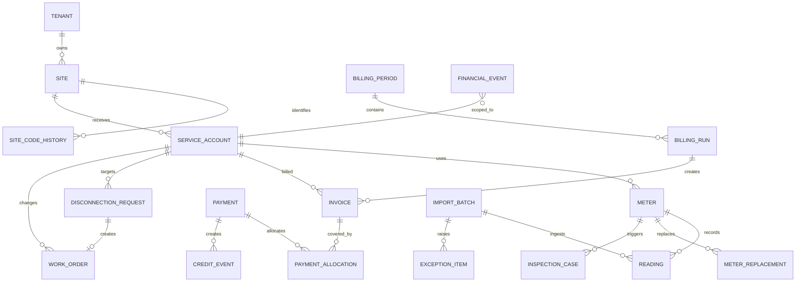

# 2. Database ERD

แบบจำลองนี้ใช้ PostgreSQL เป็นฐานข้อมูลส่วนกลาง และแยก Ledger/History ออกจาก Current State

## Constraints ที่ฐานข้อมูลต้องบังคับ

1. `service_account(site_id, service_type)` ไม่ซ้ำสำหรับบัญชีบริการที่ยังเปิด
2. `meter(service_account_id, meter_number)` และประวัติ effective date ต้องตรวจการทับช่วง
3. `reading(meter_id, billing_period_id, source_data_version)` ไม่ซ้ำ
4. `import_batch.idempotency_key`, `payment.idempotency_key`, `webhook.message_id` เป็น Unique
5. `invoice_number` เป็น Unique และ Invoice ต้องมี Service Account เดียว
6. `payment_allocation.amount > 0` และผลรวม Active Allocation ห้ามเกินยอด Payment
7. Open Inspection ต่อ `service_account_id + meter_id` ได้ไม่เกินหนึ่งรายการด้วย partial unique index
8. Financial Event, Credit Event, Deposit Event และ Audit Log เป็น append-only
9. `amount` ใช้ `Decimal(14,2)`; reading ใช้ `Decimal(18,3)`
10. ข้อมูลทางการเงินต้องมี `effective_at`, `recorded_at`, `posting_period`

ไฟล์ `prisma/schema.prisma` เป็น executable draft ของ ERD นี้ ส่วน migration จริงต้องเพิ่ม PostgreSQL constraints และ trigger ที่ Prisma แทนไม่ได้
